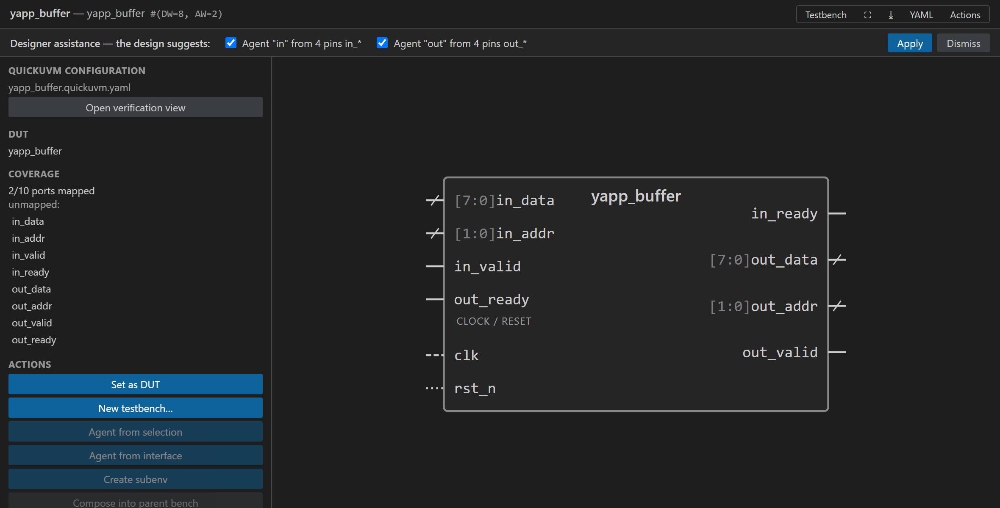
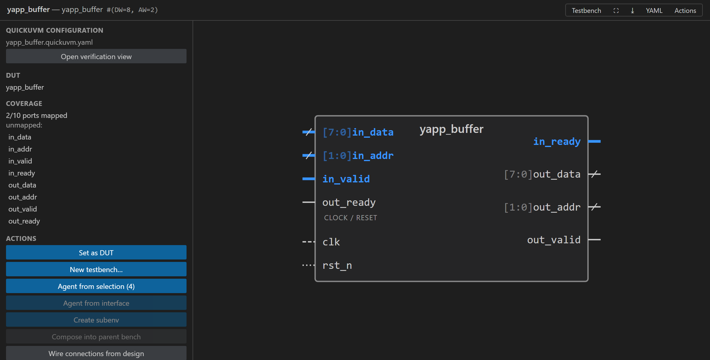
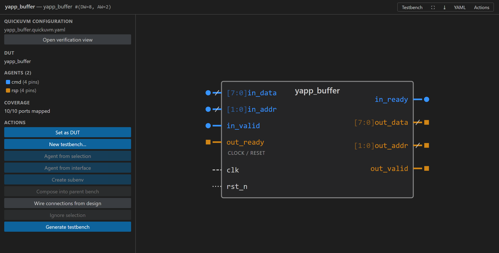
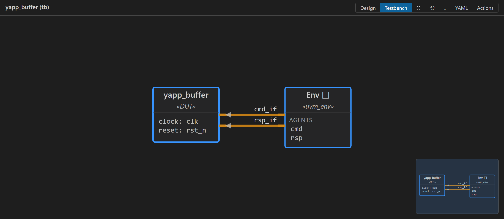
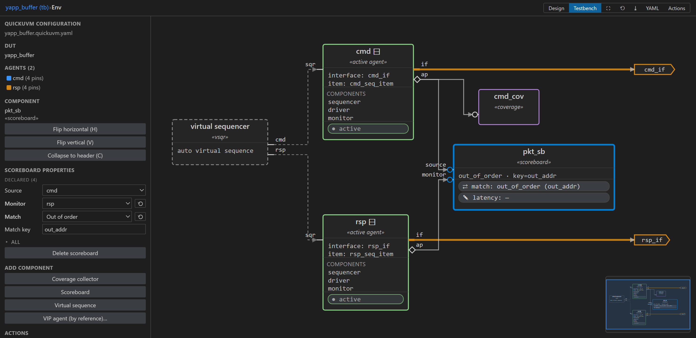
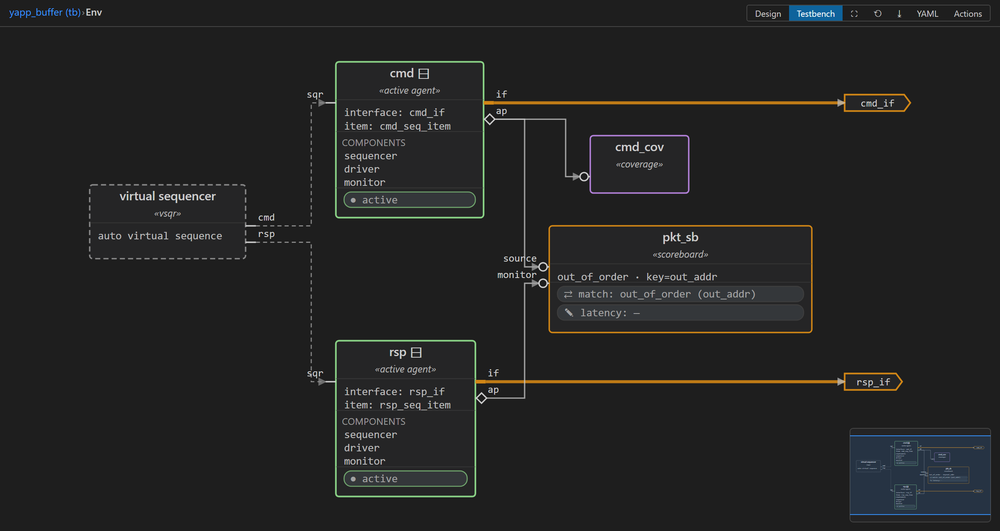
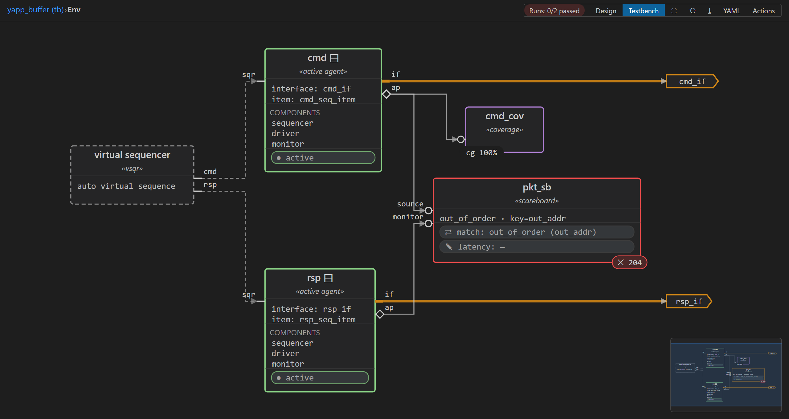

# Tutorial — a verification environment for `yapp_buffer`

This is the **MVP closure exercise** (the criterion of `docs/06-plan-mvp.md`,
slice 3b): starting from a SystemVerilog design, a verification environment
with **two or more agents, a two-stream scoreboard and a coverage collector**
is built **entirely on the diagram** — no YAML written by hand —, the diagram
is re-arranged, and at the end `quick-uvm generate` produces a clean testbench
from a readable YAML.

The fixture is [`examples-yapp/yapp_buffer.sv`](../examples-yapp/yapp_buffer.sv):
a one-slot packet buffer with a clear input / output boundary — exactly the two
agents the exercise needs.

> **Do not confuse it with the YAPP router.** The router is a 1→3 demux
> (`out0_*` / `out1_*` / `out2_*`) and lives in the other repository, at
> `QuickUVM/examples/yapp/rtl/yapp_router.sv`; it is the subject of the visual
> walkthrough [`yapp-router-walkthrough.html`](yapp-router-walkthrough.html),
> which is verified with **one** agent. The fixture here is a deliberate
> reduction of it: the `ready` handshake in both directions is what gives **two**
> agents, which is what the closure criterion asks for. (Until July 2026 the
> fixture was also called `yapp_router`, so the steps below and the
> walkthrough's captures described two different designs under one name.)

| Signal | DUT direction | Role in verification |
|---|---|---|
| `clk`, `rst_n` | in | clock + reset (given at "Set as DUT", not to an agent) |
| `in_data[8]`, `in_addr[2]`, `in_valid` | in | the **command** stream — the `cmd` agent DRIVES them |
| `in_ready` | out | the input handshake — the `cmd` agent samples it |
| `out_data[8]`, `out_addr[2]`, `out_valid` | out | the **response** stream — the `rsp` agent samples them |
| `out_ready` | in | backpressure — the `rsp` agent drives it |

> **What is verified, and how.** The design parses with `svmodel`, and the
> configuration these steps produce generates cleanly with `quick-uvm` 1.2.0
> (both scoreboard variants, in-order and out-of-order). The YAML listing of
> step 9 is compared byte for byte with what the gestures write, in
> `npm run test:e2e` — so the steps are not merely plausible. "Generates" is not
> "simulates": see step 10.

> **About the figures.** They are captures of the extension's real webview —
> the shipped bundle, fed with a real `svmodel` run of the fixture and with the
> YAML the gestures below write — taken by `npm run shots`
> (`scripts/capture-shots.mjs`), not drawings. They are not captures of a VS
> Code window: there is no activity bar, no tree and no QuickPick in them, and
> the **Properties** panel is shown to the left of the diagram, where the side
> bar is.

---

## 0. Start the Extension Development Host

In VS Code (with the extension's repository open), pick the launch
configuration **"Run the extension (tutorial: yapp_buffer)"** in the **Run and
Debug** panel and press F5. The extension is built (`npm: build`) and a new
window opens on the `examples-yapp/` folder, with `quickuvm.top = yapp_buffer`
preset.

In the new window, open the **QuickUVM Architect** side bar (its icon in the
activity bar). It has four sections: **Design Hierarchy**, **Verification
Hierarchy**, **Signals** (collapsed) and **Properties**.

> **Properties is the ONLY inspector.** The diagram has no inspector column of
> its own; it takes the whole width of the editor. Wherever a step below says
> "the inspector", it means the **Properties** panel of the side bar.

---

## 1. Open the design and set the DUT

1. **Design Hierarchy** shows the **"top module"** root and, under it,
   `yapp_buffer`. Click `yapp_buffer` → its **schematic/symbol** opens (a box
   with all the pins on its sides).
2. In the **Properties** panel of the side bar, in the configuration section,
   press **"Set as DUT"**. The extension:
   - proposes the clock (`clk`) and the reset (`rst_n`, active-low — the `_n`
     suffix) heuristically, for you to confirm;
   - creates a `yapp_buffer.quickuvm.yaml` file next to the design.

   The overlay lights up: the unmapped pins (all of them, for now) are marked, and
   `clk`/`rst_n` take the clock/reset role.

   

   > **Who drives the reset.** The reset pin is never part of an agent, so the
   > extension writes `reset: {external: true}`: the generated `tb_top.sv`
   > declares `rst_n`, holds it asserted for 5 clocks, releases it, and passes it
   > into every interface (drivers and monitors wait for the release). There is
   > no checkbox for it — the other answer (`external` off, no agent declaring
   > the port) is a bench that generates cleanly and then **fails to elaborate**:
   > `tb_top` connects the DUT to `cmd_if_inst.rst_n`, a signal `cmd_if` does not
   > have. That is exactly what this tutorial produced until Nov 2026; a config
   > from back then now shows the `reset-undriven` error, with the repair on the
   > badge and in the Problems panel.

---

## 2. The COMMAND agent (`cmd`) — from the input pins

1. In the schematic/symbol of `yapp_buffer`, **select** the pins of the command
   stream: `in_data`, `in_addr`, `in_valid` and the handshake `in_ready` (click
   each pin with Ctrl held, or drag a lasso over them).
2. The inspector shows **"Agent from selection (4)"** — press it.
3. Name it **`cmd`**. The extension inverts the perspective (docs/03): the DUT's
   **input** ports become what the agent **drives** (`in_data`, `in_addr`,
   `in_valid`), and `in_ready` (a DUT output) becomes what it **samples**.



The pins of `cmd` now take the agent's colour.

> **The strip above the canvas.** Once the DUT is set, a proposal strip offers
> `Agent "in" from 4 pins in_*` and `Agent "out" from 4 pins out_*` — the same
> two groups, found by their name prefix. Applying them is a legitimate
> shortcut; this tutorial creates the agents by hand so that they carry the
> names (`cmd`, `rsp`) the rest of the steps and the listing use. Leave the
> strip alone, or dismiss it.

---

## 3. The RESPONSE agent (`rsp`) — from the output pins

1. Select the pins of the response stream: `out_data`, `out_addr`, `out_valid`
   and the backpressure `out_ready`.
2. **"Agent from selection (4)"** → name **`rsp`**. This time `out_ready` (a DUT
   input) is what the agent drives, and `out_data` / `out_addr` / `out_valid`
   (DUT outputs) are what it samples.

You now have **2 agents** and every data pin is mapped (only `clk` / `rst_n`
remain, as clock / reset). ✔️ *"two or more agents"*



---

## 4. Open the verification diagram

Two equivalent ways — the second one validates **slice 4**:

- **A.** In the inspector, press **"Open verification view"** (or the
  **"Testbench"** button in the diagram's header).
- **B.** *(slice 4)* In the **Explorer**, double-click
  `yapp_buffer.quickuvm.yaml` → the file opens **directly as the verification
  diagram** (it is the default editor). For the raw YAML, press the **"Open
  Configuration as Text"** button in the editor's title bar; **"Open
  Configuration as Diagram"** on the text tab goes back. (The **"YAML"** button
  in the diagram's header opens the text *beside* the diagram instead.)

You see the root of the testbench: **DUT** (`yapp_buffer`) + **Env**, with one
interface per agent between them. Double-click **Env** to go down to the level
of the agents.



---

## 5. A two-stream scoreboard (`cmd` vs `rsp`)

At the **Env** level (or from the inspector's "Add component" section), press
**"Scoreboard"**. Answer the QuickPicks:

1. **Source** (the stimulus stream) → `cmd`.
2. **Monitor** (the observed stream, A2 two-stream) → `rsp`.
3. **Strategy** → **"Out of order (keyed pool — a reordering DUT)"**.
4. **Match key** → `out_addr` (the field the packets are paired by).
5. **Name** → `pkt_sb` (or keep the default, `sbd`).

> A simpler alternative: pick **"In order (FIFO pair)"** as the strategy — it
> asks for no match key, and it is correct for this one-slot buffer. Both
> generate.

A `pkt_sb` box appears, linked to both agents. ✔️ *"a two-stream scoreboard"*

Its fields can be edited later from the inspector (select the scoreboard → the
Source / Monitor / Match / Match key / Max latency editor), or from the pills
on the selected box.



---

## 6. A coverage collector (on `cmd`)

Press **"Coverage collector"** → pick the agent **`cmd`**. A coverage collector
appears, linked to `cmd`. ✔️ *"a coverage collector"*

*(Optional)* **"Virtual sequence"** → coordinates `cmd` (the active agent) — a
sequential `smoke`.



*(The blocks in this figure were placed by hand — step 7 — which is why the
wires are this straight; the automatic layout is a starting point.)*

---

## 7. Re-arrange the diagram (entirely by hand)

- **Drag** the boxes (DUT, Env, agents, scoreboard) where you want them — the
  positions are kept in the sidecar (`.vscode/quickuvm-architect.yaml`).
- **H** / **V** on a selected block flips its ports horizontally / vertically;
  **H** on a boundary flag is a local flip.
- The **⟲** button re-arranges everything (back to the automatic layout).
- **Delete** / right-click on a component removes it (after a confirmation) —
  if you want to correct something.

None of this touches the YAML text. ✔️ *"re-arranged entirely on the diagram"*

---

## 8. Generate the testbench

Press **"Generate testbench"** — the ▷ button in the title bar of the
**Properties** panel, the button in the panel's body, or the command from the
palette. (NOT in the diagram's header: what is there is only the *status chip*
of the last generate.) The extension runs `quick-uvm generate` (falling back to
`python -c` when `quick-uvm` is not on the PATH) and writes the testbench into
`quickuvm.outputDir` (`tb/` by default).

Key files to expect:
`cmd_if.sv`, `rsp_if.sv`, `cmd_cov.svh`, `yapp_buffer_scoreboard.svh`,
`yapp_buffer_env.svh`, `yapp_buffer_virtual_sequencer.svh`, `tb_top.sv`.

---

## 9. Check the result

- **Readable YAML**: open `yapp_buffer.quickuvm.yaml` as text — it must look like
  the listing below, clean and editable by hand.
- **A clean `generate`**: no errors in the **Problems** panel or in the
  **QuickUVM Architect** output channel.

```yaml
# QuickUVM configuration — created by QuickUVM Architect, editable by hand too.
# The extension keeps the comments and the fields it does not know.
project:
  name: yapp_buffer

clock:
  period: 10
  unit: ns

tests:
  - { name: yapp_buffer_test }
dut:
  name: yapp_buffer
  clock: clk
  reset: rst_n
reset:
  external: true
agents:
  - name: cmd
    interface: cmd_if
    sequence_item: cmd_seq_item
    ports:
      inputs:
        - { name: in_data, width: 8 }
        - { name: in_addr, width: 2 }
        - { name: in_valid }
      outputs:
        - { name: in_ready, randomize: false }
  - name: rsp
    interface: rsp_if
    sequence_item: rsp_seq_item
    ports:
      inputs:
        - { name: out_ready }
      outputs:
        - { name: out_data, width: 8, randomize: false }
        - { name: out_addr, width: 2, randomize: false }
        - { name: out_valid, randomize: false }
analysis:
  scoreboards:
    - { name: pkt_sb, source: cmd, monitor: rsp, match: out_of_order, match_key: out_addr }
  coverage: [ cmd ]
```

> Details that confirm this is the real YAML, not an idealised one — the listing
> is compared byte for byte with what the mutations write, in `npm run test:e2e`
> (scenario 15), which also generates it and checks the reset wiring:
> - 1-bit ports carry no `width` (QuickUVM's default is 1), so
>   `in_valid`/`in_ready`/`out_ready`/`out_valid` have none;
> - the top-level `reset:` block holds **who drives the reset and its polarity**
>   (quick-uvm >= 1.0 — the old `dut.reset_active_low` / `dut.external_reset`
>   keys are rejected). `external: true` = the testbench top generates the
>   reset (see step 1). `active_low` is absent because active-low is QuickUVM's
>   default; an active-high reset gets `active_low: false` next to it;
> - the ports an agent **samples** (the DUT's outputs) get `randomize: false` —
>   they are not stimulus.
> - the two comment lines at the top are the skeleton's own (still in
>   Romanian); they are part of what the extension writes, so the listing keeps
>   them.

---

## Checklist — the closure criterion

- [ ] A real design opened from the hierarchy (no YAML written by hand).
- [ ] The DUT set from the diagram, with the clock / reset detected.
- [ ] **Two or more agents** (`cmd`, `rsp`) created from a pin selection.
- [ ] A **two-stream scoreboard** (`cmd` → `rsp`) added on the diagram.
- [ ] A **coverage collector** (on `cmd`) added on the diagram.
- [ ] The diagram re-arranged (drag / flip); the positions survive a reopen.
- [ ] `yapp_buffer.quickuvm.yaml` opened as **the verification diagram** (slice 4).
- [ ] **Readable YAML** at the end.
- [ ] **A clean `quick-uvm generate`**, the testbench produced in `tb/`.

If all are ticked, **the MVP is validated**.

---

## 10. Simulate it (optional — needs a simulator)

"Generates cleanly" is not "elaborates", and "elaborates" is not "passes": the
extension cannot run a simulator. What is known about this bench comes from
compiling it by hand (Xcelium 25.09, Nov 2026):

- **It elaborates.** `tb/run.f` lists the files; replace the generated stub
  `tb/yapp_buffer.sv` with the real `yapp_buffer.sv`. The reset connection to
  look for in `tb/tb_top.sv` is `.rst_n(cmd_if_inst.rst_n)` with `cmd_if`
  declared as `interface cmd_if (input clk, input rst_n);`.
- **As generated, it stops with `UVM_FATAL [UNFILLED_PREDICTOR]`.** A
  two-stream scoreboard comes with a reference model whose prediction is a
  seam for you to fill — `tb/yapp_buffer_reference_model.svh`, between the
  `prediction_logic` pragmas. The stub fails on purpose: left empty it would
  compare what was observed with itself and report a green bench that measures
  nothing. Write the model there (for this buffer: what goes in comes out), or
  remove the scoreboard if you only want the bench to run — without it the
  bench runs to `$finish` with no error.

To see the results **on the diagram**:

1. In the inspector, with nothing selected at the testbench level, open
   **Regression** and press **"Add regression"** (it writes `regress: {}`),
   then **"Generate testbench"** again — `tb/Makefile` appears.
2. On a machine with the simulator, run `make regress` in `tb/` (a Makefile
   generated on Windows has CRLF line endings — convert it first). It writes
   `tb/out/runs/<test>.<seed>/{status, sim.log}` and, with coverage on,
   `tb/out/cov/summary.txt`.
3. Back in VS Code, with those files under the workspace's `tb/out/`, the
   verification diagram shows them: the runs' verdicts in the header
   ("Runs: 1/2 passed"), an error count on the block that raised it (here
   `pkt_sb`: the predictor's fatal, or the comparator's mismatches), the
   covergroup figure on the `cmd` collector and the code-coverage figures on
   the DUT. **"Refresh Simulation Results"** re-reads the files; a click on the
   header chip opens the report.



*(This figure is drawn from the logs of a real Xcelium regression of this very
bench, run with a deliberately wrong prediction — hence the comparator's
mismatches.)*

> This step has been checked piece by piece — the log parsing and the
> attribution on real Xcelium logs of this very bench, the drawing in the
> webview harness — but **not yet walked end to end in a VS Code window**.
> Doing it is the manual pass the results feature still needs.

---

## Beyond the closure exercise

The steps above are the MVP's path. Things added since, worth trying on the
same bench (each is described in `docs/05-ui-si-protocol.md`):

- **The short way to the same bench.** In a copy of `examples-yapp/` without
  `yapp_buffer.quickuvm.yaml`, run **"New Testbench…"** (the Design Hierarchy's
  title bar, or the inspector's button) and pick **"One agent per interface"**:
  it proposes the DUT section and two agents, `in` and `out`, with the same
  pins as `cmd` and `rsp`, and asks before it creates the file. (The other two
  templates say why they do not apply here: one clock, no sub-blocks. A
  template never overwrites an existing configuration.)
- **Signals** (side bar): the clock `clk` and the reset `rst_n` with both
  agents under them. With one clock and one reset there is nothing to assign;
  on a bench with several domains, dragging an agent onto one writes its
  `clock:` / `reset:`.
- **On the canvas**: drag from a port's hotspot to create or connect
  (`Ctrl+Space` lists every legal action for the selection); `F2` renames in
  place; `C` collapses a block to its header; `Ctrl+F` finds; `Shift+G` frames
  the selection and `N` adds a note (kept in the sidecar, never in the YAML).
- **Filters**: right-click on the background → **"Filters…"** (hide / dim /
  colour by kind and name, per view); while a view has rules, a chip in the
  header says what they do. **Matrix**: agents × scoreboards as a table — from
  the action palette, and as a header button on larger benches.

Like step 10, the template flow and the Signals view's drag-and-drop are tested
at the level of their rules and **have not had a manual pass in a VS Code
window yet**.
